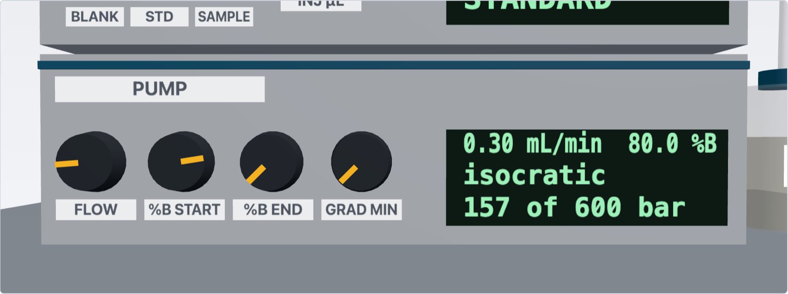
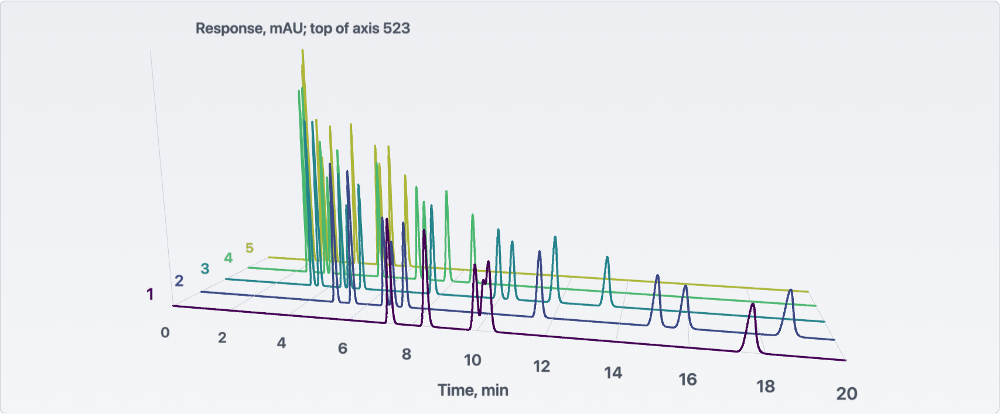

# Method Bench

An open reversed-phase LC method-development simulator for teaching.

**[Open the demo](https://johncourie.github.io/method-bench/)** · runs in the browser, nothing to install, no account, no tracking.

[](https://johncourie.github.io/method-bench/#instrument)

Students make the decisions a chromatographer makes: column, gradient, pH and buffer, temperature, flow, detector. They run injections that cost instrument time, read chromatograms that are not labelled for them, fit a retention model from their own scouting runs, and take a method through system suitability, calibration, quantitation of an unknown, and the validation characteristics of ICH Q2(R2).

It is a teaching instrument. It is not a substitute for commercial method-modelling software, it controls no real instrument, and nothing in it should be used to justify a regulated method.

## Try it

| Go to | What is there |
|---|---|
| [Setup](https://johncourie.github.io/method-bench/#setup) | Choose a case, enter an assignment code, pick an instrument. Use `DEMO-0001` to explore. |
| [Instrument](https://johncourie.github.io/method-bench/#instrument) | The instrument, the method and sample forms, the chromatogram and its peak table. |
| [Compare runs](https://johncourie.github.io/method-bench/#compare) | Overlay runs or spread them into a waterfall, coloured by a variable you choose. |
| [Fit and predict](https://johncourie.github.io/method-bench/#model) | Fit a retention model from your own runs, predict a method, survey resolution. |
| [Quantitation](https://johncourie.github.io/method-bench/#quant) | Calibration, weighting, residuals, limits, sample results, recovery. |
| [Suitability and validation](https://johncourie.github.io/method-bench/#validation) | System suitability and an ICH Q2(R2) evidence table. |
| [Report](https://johncourie.github.io/method-bench/#report) | A printable method report with a notebook fingerprint. |
| [Model and limits](https://johncourie.github.io/method-bench/#limits) | Equations, where every parameter comes from, checks against the literature, the debrief. |
| [Instructor](https://johncourie.github.io/method-bench/#instructor) | Assignment codes and the key. |

A first session, five minutes: open [Setup](https://johncourie.github.io/method-bench/#setup), choose a case, press Start, press Inject. Nine or ten peaks appear, none of them named. Inject single standards to find out which is which, change the gradient, and watch the separation change.

## Two cases

- **Green tea catechins.** Eight catechins and caffeine in a leaf extract with a label claim. Three C18 columns and a pentafluorophenyl phase in two formats.
- **Hemp cannabinoids.** Ten acidic and neutral cannabinoids in milled flower, with a total-THC compliance decision. Four stationary phases.

Each assignment code gives a student their own reproducible unknown, with one of four hidden situations per case: an unremarkable lot, a co-eluting interferent, a degraded lot, an adulterated or out-of-specification lot.

## What makes it different from a slider demo

- **The model is hidden and experiments cost something.** Peaks are not named. The student identifies them with standards and builds a retention model from two or more of their own runs. The true parameters appear only in a debrief, and opening the debrief is recorded.
- **The signal is integrated, not looked up.** A detector trace with noise, drift and tailing is synthesized, then a peak-detection routine that sees only the trace integrates it. Co-elution, a sloping baseline or a wide calibration range corrupt results the way they do on an instrument.
- **Every number says where it came from.** Each parameter is labelled reported, digitized, fitted or assumed, with its source. [Model and limits](https://johncourie.github.io/method-bench/#limits) states what the tool cannot tell you.
- **It is checked against the literature in the open.** Published methods are re-run in the simulator and the differences are shown, including one that does not agree.
- **The notebook reproduces everything.** One file holds every injection and every processing choice. It gives the same numbers on any machine, which is what an instructor marks from.

## The instrument

[](https://johncourie.github.io/method-bench/#instrument)

The [Instrument](https://johncourie.github.io/method-bench/#instrument) tab opens with a drawing of a generic liquid chromatograph that can be operated. Select a module to look closer.

| Module | On the drawing |
|---|---|
| Solvents | pH of solvent A, and its buffer (formate, acetate or phosphate) |
| Pump | Flow, starting % B, ending % B, gradient time |
| Autosampler | Blank, standard or sample vial; injection volume; Inject |
| Column oven | Previous and next column; temperature. The door opens and the column is drawn to its real length and bore. |
| Detector | UV or mass detector; wavelength or selected ion |

Knobs turn by dragging sideways or scrolling over them. After an injection the needle samples the chosen vial, the front panels replay the run (composition, pressure, detector reading) and solvent moves through the tubing, tinted by composition. With reduced motion set in the operating system nothing animates.

Three rules shape the drawing:

- **It is generic.** Plain modules, this project's own palette, name plates and readouts. It represents the class of instrument, not any maker's product.
- **It shows only what an operator could see.** Nothing inside the column is drawn, because that would hand the student the answer.
- **The form is an equal route.** Every control on the drawing changes the same method the form below it edits. The form also holds what a front panel would not: the full gradient table, sample preparation, spiking, forced degradation and replicate injections. It is the keyboard and screen-reader route, and the page works with WebGL off.

## Comparing runs

[](https://johncourie.github.io/method-bench/#compare)

[Compare runs](https://johncourie.github.io/method-bench/#compare) overlays chromatograms or pulls them apart into a waterfall that can be turned. Colour can stand for the run, the kind of sample, the column, the buffer, temperature, pH, flow, gradient time, starting % B or injection volume. Each trace carries its run number, and a table under the view lists every trace with its value, so colour is never the only carrier.

## How far to trust it

Read [`docs/MODEL.md`](docs/MODEL.md) and [`docs/DATA.md`](docs/DATA.md) before relying on any number. In brief:

- **Cannabinoids** are built on published measurements: retention factors and their dependence on acetonitrile on four columns, and a pH response digitized from a published figure and validated against the same paper's tables. A published gradient on a different C18 is predicted within 6%.
- **Catechins** are weaker. No open source reports their retention against solvent composition, so parameters are fitted to retention times from seven published methods. A method left out of the fit is predicted with an rms error of 4 to 16% in retention time once its column strength is fitted, with single compounds off by up to 31%.
- **Not modelled:** methanol as solvent B (no open data), temperature selectivity (one enthalpy per case), curvature of retention against % B, buffer-specific selectivity, and ionic strength. Because the simulator's own retention model is log-linear, a model fitted from two runs predicts better here than it would on an instrument. The application says each of these where it matters.
- **Assumed values** are labelled as assumed: detector noise, peak tailing, extraction recovery, most degradation rates, the mass detector's response.

No vendor's code, data, interface or terminology is used. Sources under non-commercial licences, including the best-known open LC simulator and the public column-selectivity database, were read but not copied. Commercial tools for professional method development exist and are worth paying for.

## For instructors

See [`docs/INSTRUCTOR.md`](docs/INSTRUCTOR.md) for setting an exercise, the hidden situations, marking, and six suggested exercises.

In brief: generate assignment codes on the [Instructor](https://johncourie.github.io/method-bench/#instructor) tab, hand one to each student, and ask for the printed report and the notebook file. Load a student's notebook on the Setup tab to see exactly what they saw.

The key is computed in the page, as it must be for a static site, so a student who looks can find it, and a student can restart a notebook. The notebook file records every injection and every processing choice, which shows whether a result was earned. Mark the method and the reasoning, not only the number.

## Accessibility

Every chart and drawing has a table or form carrying the same information. All controls outside the two WebGL views work from the keyboard, and those two views have keyboard or form equivalents. Every tab is scanned for WCAG 2.1 AA violations at desktop and phone widths in both themes as part of the test suite. An automated scan is not a substitute for testing with the people who will use it, and no screen-reader user has yet tested this.

## Run it locally

Needs Node 22.18 or later.

```sh
npm install
npm run dev        # development server
npm run test:run   # engine, data, scripted-student and regression tests
npm run build      # static site in dist/
npm run e2e        # browser tests, accessibility scan, phone-width checks
```

The data set in `src/data/` is generated. To rebuild it from the transcribed tables:

```sh
node tools/fit-catechins.ts
node tools/fit-cannabinoid-ph.ts
node tools/build-data.ts
```

Pushing to `main` runs the tests and deploys the [demo](https://johncourie.github.io/method-bench/) through GitHub Pages.

## How it is built

A static site: strict TypeScript, Vite, Vitest, Playwright, no framework. One runtime dependency, three.js, fetched only when a drawing is shown.

| Path | What |
|---|---|
| [`src/engine/`](src/engine) | Pure, deterministic numerics with no DOM: retention, gradient migration, band broadening, detectors, integration, calibration statistics, model fitting. |
| [`src/lab/`](src/lab) | The teaching layer: cases, sample preparation, degradation, the notebook, and the quantitation and validation derived from it. |
| [`src/data/`](src/data) | Generated data set, with a provenance record on every value. |
| [`src/ui/`](src/ui) | Views. [`src/ui/three/`](src/ui/three) holds the instrument drawing and the run comparison. |
| [`tools/`](tools) | Transcribed source tables, fitting scripts, the data build. |
| [`tests/`](tests), [`e2e/`](e2e) | Golden tests against closed-form results, literature reproduction, a scripted student, regressions from two adversarial reviews, browser and accessibility tests. |
| [`docs/`](docs) | [Model](docs/MODEL.md), [data and provenance](docs/DATA.md), [instructor guide](docs/INSTRUCTOR.md), [decisions](docs/DECISIONS.md). |

Two rules hold the design together. The student-facing side never reads the engine's truth: peak tables come from integrating the trace, and results come from the peaks the student named. And no view owns a setting: the drawing and the form both change one method and are redrawn from it. Project rules for contributors are in [`CLAUDE.md`](CLAUDE.md).

## Contributing data

The most useful contribution is measured retention data. For catechins on C18, isocratic retention factors at three or four acetonitrile fractions and two temperatures would replace every fitted and assumed value in that case. The same with methanol would let the simulator offer a second organic modifier honestly. The data schema (`RetentionParams` in [`src/engine/types.ts`](src/engine/types.ts)) takes measured values without code changes. [`docs/DATA.md`](docs/DATA.md) lists what else would help.

## Patents

Software patents exist in the general area of chromatographic method development, among them US 12,693,275 (Shimadzu) and US 9,958,423 (Biotage). This project controls no instrument, and its resolution survey follows the window-diagram method published by Laub and Purnell in 1975. That is the author's reading, not legal advice. If you plan to build a commercial product on this code, take advice.

## Licence

Code: MIT ([`LICENSE`](LICENSE)). Data, documentation and teaching text: CC BY 4.0 ([`LICENSE-DATA.md`](LICENSE-DATA.md)).

John Courie, 2026. Built with Claude.
